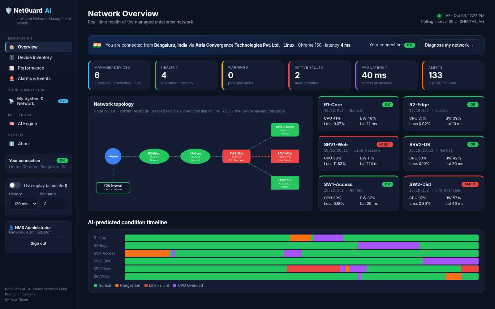
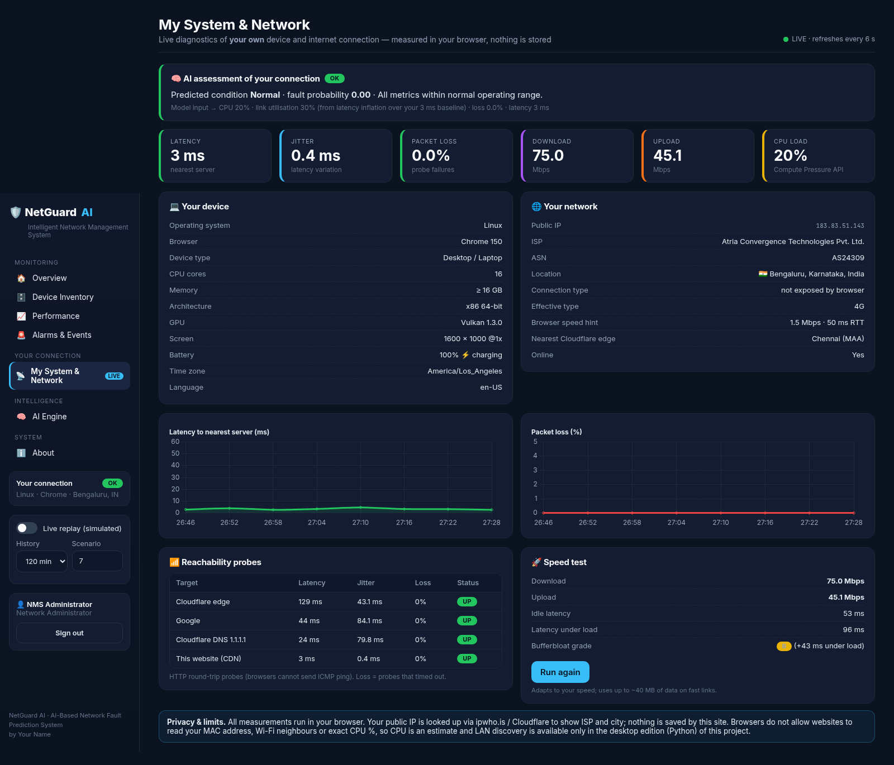
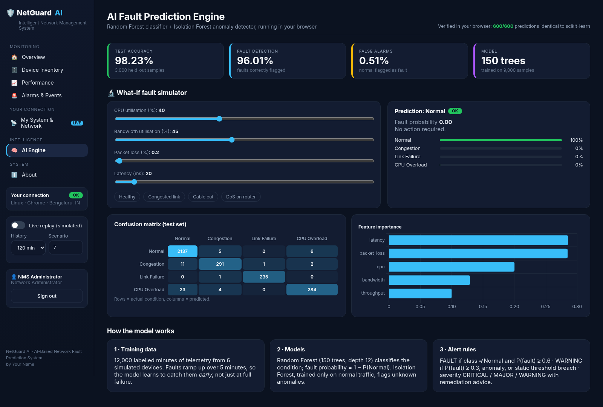

# 🛡️ NetGuard AI: Intelligent Network Management System

**AI-based network fault prediction and monitoring console that adapts to whoever opens it.**

### 🔗 Live demo: **https://nagavarshinik16.github.io/netguard-ai/**
Demo login: `admin` / `adminnms`



NetGuard AI predicts network faults with machine learning. A Random Forest classifier (98.2% accuracy)
analyses CPU, bandwidth, packet-loss and latency telemetry. It labels every device **Normal / Congestion /
Link Failure / CPU Overload**, catches faults *while they are still developing*, and raises graded alarms
with a probable cause and a recommended fix.

**It adapts to each visitor.** When someone opens the link, the console measures *their own* device and
internet connection inside their browser: OS, browser, CPU, GPU, ISP, city, latency, jitter, packet loss,
download/upload speed and bufferbloat. It then runs the same AI model on those measurements and shows
the AI's verdict on their connection. Every viewer sees their own data.

---

## ✨ Features

| | |
|---|---|
| 🔐 **Secure console login** | Salted SHA-256 credential check, lockout after 5 failed attempts |
| 🏠 **Network overview** | KPIs, **live animated topology** coloured by AI status (link failures drawn as red dashed lines), the **viewer's own device shown as a node**, condition timeline |
| 🗄️ **Device inventory** | IP, MAC, vendor, model, OS, serial, location, uptime, SNMP version, per-interface status, utilisation, traffic and errors |
| 📈 **Performance** | CPU / bandwidth / loss / latency trends with thresholds; every point is coloured by the AI prediction |
| 🚨 **Alarms & events** | CRITICAL / MAJOR / WARNING alarms with filters, remediation advice and CSV export |
| 📡 **My System & Network** | **Real-time diagnostics of the visitor's own device and connection**, plus the AI's assessment of it |
| 🧠 **AI engine** | Interactive *what-if* simulator, confusion matrix, feature importance, and an in-browser check that the JS model is identical to scikit-learn |
| ▶️ **Live replay** | Streams the simulated enterprise network minute by minute |
| 📱 **Responsive** | Works on desktop, tablet and phone |

<p align="center">
  
  
</p>

---

## 🧠 How it works

```
                 OFFLINE (Python)                                    ONLINE (visitor's browser)
 ┌──────────────────┐   ┌──────────────────┐   ┌───────────────┐   ┌──────────────────────────────────────┐
 │ generate_data.py │──►│ train_model.py   │──►│export_model.py│──►│ docs/assets/model.json               │
 │ 12,000 labelled  │   │ Random Forest +  │   │ forests → JSON│   │   │                                  │
 │ telemetry rows   │   │ Isolation Forest │   └───────────────┘   │   ▼                                  │
 └──────────────────┘   └──────────────────┘                       │ model.js  (exact JS port, verified)  │
                                                                   │   ▲              ▲                   │
                                         simulated enterprise ─────┘   │              │ visitor's device │
                                         network (sim.js) ─────────────┘              │ & network        │
                                                                                      │ (probe.js)       │
                                                                   │   ▼                                  │
                                                                   │ Alert engine → dashboard (app.js)    │
                                                                   └──────────────────────────────────────┘
```

1. **Data.** Six devices (2 routers, 2 switches, 2 servers) produce per-minute telemetry. Faults **ramp up over 5 minutes**, so the model learns to recognise them early instead of only at full failure.
2. **Model.** A **Random Forest** (150 trees) classifies the condition, and fault probability = 1 − P(Normal). An **Isolation Forest** trained only on normal traffic flags unknown anomalies.
3. **Alert rules.** FAULT if the class ≠ Normal and P(fault) ≥ 0.6. WARNING if P(fault) ≥ 0.3, an anomaly is detected, or a threshold is breached. Each alarm gets a severity and a remediation hint.
4. **Browser inference.** `export_model.py` serialises every tree to JSON, and `model.js` re-implements scikit-learn's traversal, including float32 comparisons and Isolation-Forest path-length scoring. `tests/verify_web_model.mjs` checks **600/600 identical predictions**.
5. **Adapting to the viewer.** `probe.js` measures the visitor's system and network and maps the results onto the model's five features:

| Visitor data | Browser technique |
|---|---|
| OS, browser, device type, CPU cores, RAM, GPU, screen, battery | User-Agent Client Hints, `navigator` APIs, WebGL, Battery API |
| Public IP, ISP, ASN, city, nearest edge | ipwho.is, with Cloudflare trace/edge metadata as fallback |
| Latency, jitter, packet loss | Repeated timed HTTP probes to Cloudflare, Google, 1.1.1.1 and the site's own CDN |
| Download, upload, bufferbloat | Timed transfers to Cloudflare speed endpoints while measuring latency under load |
| CPU load | Compute Pressure API, or an event-loop-lag estimate |
| Link utilisation (model feature) | Latency inflation over the session's baseline RTT (queueing-delay principle) |

> **Privacy:** everything is measured client-side and nothing is stored. Browsers do not let websites read
> MAC addresses, Wi-Fi neighbours or exact CPU %. The **desktop edition** (Python) covers those:
> ARP-based LAN discovery, ICMP ping and psutil host metrics.

### Results
| Metric | Value |
|---|---|
| Test accuracy | **98.2 %** |
| Fault detection rate | **96.0 %** |
| False-alarm rate | **0.5 %** |
| Accuracy on 5 unseen scenarios | 98.0 – 98.8 % |
| JS vs scikit-learn agreement | **600 / 600** |

---

## 🗂️ Repository structure

```
├── docs/                      ← the hosted web app (GitHub Pages serves this folder)
│   ├── index.html
│   ├── assets/  style.css · model.json · architecture.png
│   └── js/      app.js (UI + router) · model.js (AI engine) · probe.js (visitor telemetry)
│                sim.js (simulated network + inventory) · auth.js · config.js
├── generate_data.py           ← synthetic telemetry generator
├── train_model.py             ← trains + evaluates the models
├── export_model.py            ← exports the forests to docs/assets/model.json
├── tests/                     ← JS-vs-Python equivalence + simulator accuracy tests
├── dashboard.py, live_network.py, inventory.py, auth.py, ui.py, fault_predictor.py, monitor.py
│                              ← desktop / LAN edition (Streamlit), see DESKTOP_EDITION.md
├── run_windows.bat, setup_and_run.ps1, run.sh   ← one-click desktop setup + LAN hosting
├── data/ · models/ · outputs/ · screenshots/
└── NMS_MiniProject_Report.docx
```

---

## 🚀 Run it yourself

### Web edition (no installation)
```bash
cd docs
python -m http.server 8000        # then open http://localhost:8000
```

### Retrain the model and re-export it to the web app
```bash
python -m venv venv
source venv/bin/activate          # Windows: venv\Scripts\activate
pip install -r requirements.txt
python generate_data.py           # 12,000 labelled records
python train_model.py             # metrics -> outputs/metrics.txt
python export_model.py            # -> docs/assets/model.json
node tests/verify_web_model.mjs   # JS == scikit-learn check
node tests/verify_simulation.mjs  # JS simulator accuracy check
```

### Desktop / LAN edition (Python, with LAN device discovery)
Windows: double-click `run_windows.bat`. Linux/macOS: run `./run.sh`. Full guide: **[DESKTOP_EDITION.md](DESKTOP_EDITION.md)**.

---

## ☁️ Deploy your own copy (GitHub Pages)
1. Push this repository to GitHub.
2. Go to **Settings → Pages → Build and deployment**, set **Source: Deploy from a branch**, pick branch **`main`** and folder **`/docs`**, then click **Save**.
3. After about a minute the site is live at `https://<username>.github.io/<repo>/`.
4. Edit `docs/js/config.js` to set your name and links.

---

## 🛠️ Tech stack
**Python** (scikit-learn, pandas, NumPy, Matplotlib, Streamlit, psutil) · **JavaScript** (ES modules, Chart.js, SVG) ·
**Web APIs** (Client Hints, Compute Pressure, Network Information, WebGL, Fetch streams) · **GitHub Pages**

## 👤 Author
**nagavarshinik16**. [GitHub](https://github.com/nagavarshinik16) · [LinkedIn](#)
